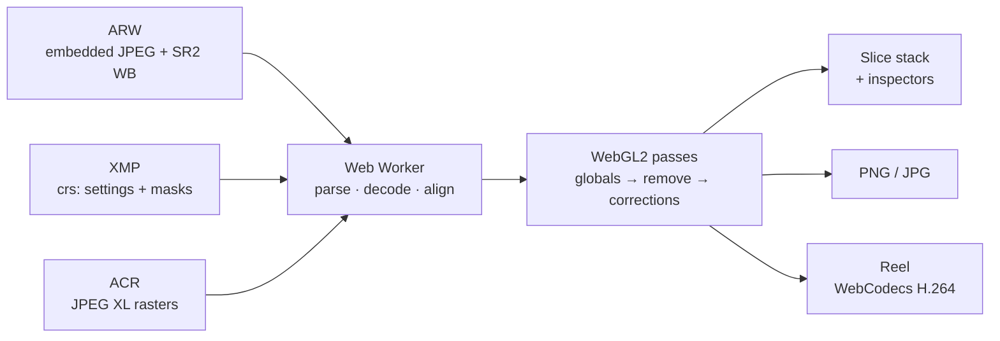

# LR Sidecar Compiler

**Rebuild a Lightroom edit layer by layer, in your browser.**

Drop a Sony ARW and its Camera Raw XMP. Include the ACR sidecar when the edit references AI rasters or Remove patches. LR Sidecar Compiler reads the edit as a program and replays every global setting, AI mask and local correction on the GPU. Each pass is drawn as a slice in an animated stack. You can compare the result against the camera's rendering, and export it as an image or as a vertical Instagram Reel.

[](LICENSE)
[](https://lr-sidecar.byronwai.workers.dev/)
[](#privacy)

**[Open the compiler →](https://lr-sidecar.byronwai.workers.dev/)** · [Read the format notes](https://byronwai.github.io/2026/11/16/Lightroom-RAW-Sidecars/)

---

## Features

- **Reads the real files.** It reads:
  - TIFF/ARW containers, including the embedded full-size JPEG preview and Sony SR2 white balance
  - Camera Raw XMP settings and the `MaskGroupBasedCorrections` stack
  - the ACR companion file, whose JPEG XL tiles hold the AI mask rasters and Generative Remove patches
- **Replays the edit on WebGL2.** Global tone, colour, HSL, curves and colour grading, then each local correction through its mask: AI subject/background/sky masks, linear and radial gradients, luminance and colour ranges, brush strokes and Generative Remove. Masks are combined with add, subtract and intersect.
- **Aligns AI masks with the lens.** Sony's camera JPEG has in-camera distortion correction baked in, but Lightroom stores AI masks in the uncorrected sensor frame. The compiler reads `aux:LensDistortInfo` and checks which hypothesis matches the image edges (Auto / Warp / Off). It then remaps the masks, so subject edges don't get halos.
- **Shows its work.**
  - An interactive isometric slice stack shows one slice per pass, with its mask, parameters and timing. You can inspect any pass.
  - A before/after slider compares the camera preview with the compiled frame.
  - Inspectors show every IFD, XMP setting and ACR record.
- **Exports.**
  - Full-resolution PNG / JPG.
  - A 1080 × 1920 **Instagram Reel**:
    - beat-cut at 120 BPM
    - passes chosen by measured visual impact
    - the XMP values typed out beside the photo
    - a seamless loop
    - a cover JPG
  - The Reel is encoded offline with WebCodecs (H.264 High, exact 30 fps), and runs faster than real time.

## Privacy

Everything runs in your browser. Photos, sidecars and exports never leave your device: the page makes no requests to other origins, and fonts and decoders are served from this repository.

## How it works



| File | Role in the "program" | What the compiler reads |
|---|---|---|
| `.ARW` | input texture | the largest embedded JPEG preview, orientation, Sony SR2 white balance |
| `.xmp` | the program | global `crs:` settings, correction stack, mask geometry, lens distortion coefficients |
| `.acr` | baked textures | content-addressed JPEG XL rasters for AI masks and Remove patches (MD5-checked) |
| `.jpg` / `.jpeg` *(optional)* | finished photo | your edited export, used for accurate final colours on the Reel cover, opening and ending |

You can add, replace or remove the edited JPG in the Reel section after compiling.
The slice walkthrough always uses the reconstructed passes. Without a JPG, the
finished-photo shots use the compiled image. Adding a JPG does not recompile the
edit or change the compiled PNG/JPG downloads. A different crop fits within the
fixed photo area without stretching.

The [format notes](https://byronwai.github.io/2026/11/16/Lightroom-RAW-Sidecars/) describe the ACR container and the XMP correction model in detail.

## Accuracy and limits

This is an **approximation** of Lightroom, not a raw developer.

- It starts from the camera's sRGB JPEG, not the sensor data. Adobe's camera profiles, raw tone mapping and process-version operators are approximated, so colour can differ from a Lightroom export. Very steep local curves amplify those differences.
- Lens alignment is applied to AI rasters only. Gradients, radials, brush strokes and Remove patches are placed in image coordinates.
- Sony ARW is the supported raw container. Other formats aren't parsed.

## Browser support

| Feature | Requirement |
|---|---|
| Compile and inspect | WebGL2 and module workers (current Chrome, Edge, Firefox, Safari) |
| Reel export, fast path | WebCodecs `VideoEncoder` with H.264 (Chromium-based browsers) |
| Reel export, fallback | `MediaRecorder` with MP4/H.264 recording in real time; keep the tab visible |

## Getting started

The app is a static site, so any static file server works:

```sh
npm run serve           # python -m http.server 4100 --directory public
```

Open <http://localhost:4100/>. Choose an ARW with its XMP and ACR (and optionally your Lightroom JPG), then select **Compile edit**.

## Tests

The sample photos aren't distributed with the repository. Point the tests at a folder that holds one ARW with its XMP and ACR:

```sh
npm test -- /path/to/sample        # format parsing, MD5s, bindings, WB (Node)
npm run test:browser -- /path/to/sample
```

The browser test drives Chrome through the DevTools protocol. Start Chrome with `--remote-debugging-port=9223` and run `npm run serve` first. Set `LR_SIDECAR_URL` to test a different deployment.

## Deploy

The site is served as static assets by Cloudflare Workers ([`wrangler.jsonc`](wrangler.jsonc)). Deploys are automatic through [GitHub Actions](.github/workflows/deploy.yml):

- **Push to `main`:** deploys to production.
- **Push to any other branch:** uploads a preview version with its own URL, and production is untouched.

The workflow needs two repository secrets: `CLOUDFLARE_API_TOKEN`, a token from the *Edit Cloudflare Workers* template, and `CLOUDFLARE_ACCOUNT_ID`.

To deploy by hand:

```sh
npm run deploy          # npx wrangler deploy
```

## Project structure

```text
public/
  index.html, style.css, main.js   page UI, slice stack wiring, inspectors
  worker.js                        parsing, decoding and rendering off the main thread
  formats/                         TIFF/ARW, Sony WB, XMP and ACR readers
  render/                          WebGL2 pipeline, shaders, lens alignment
  anim/                            slice stack and pass summaries
  reel.js, reel/                   Reel timeline, scenes, encoder, fonts
  vendor/                          JPEG XL decoder, MP4 muxer (third-party)
test/                              Node self-test and browser tests
docs/                              verification notes for the Reel and UI
```

## Credits

- JPEG XL decoding by [`@jsquash/jxl`](https://github.com/jamsinclair/jSquash); MP4 muxing by [`mp4-muxer`](https://github.com/Vanilagy/mp4-muxer).
- Typefaces: Geist, Inter, JetBrains Mono, Noto Sans TC and Space Mono, all under the SIL Open Font License.
- The visual language (terminal panes, phosphor glow, beat-cut motion) is inspired by MisakaZentai's code-rendered PVs [world.execute(me);](https://github.com/MisakaZentai/world-execute-me-dsh-pv) and [world.search(you);](https://github.com/MisakaZentai/world-search-you-dsh-pv). No assets are reused.

## Licence

[Apache License 2.0](LICENSE). Third-party components keep their own licences; see [NOTICE](NOTICE).

Not affiliated with or endorsed by Adobe or Sony.
